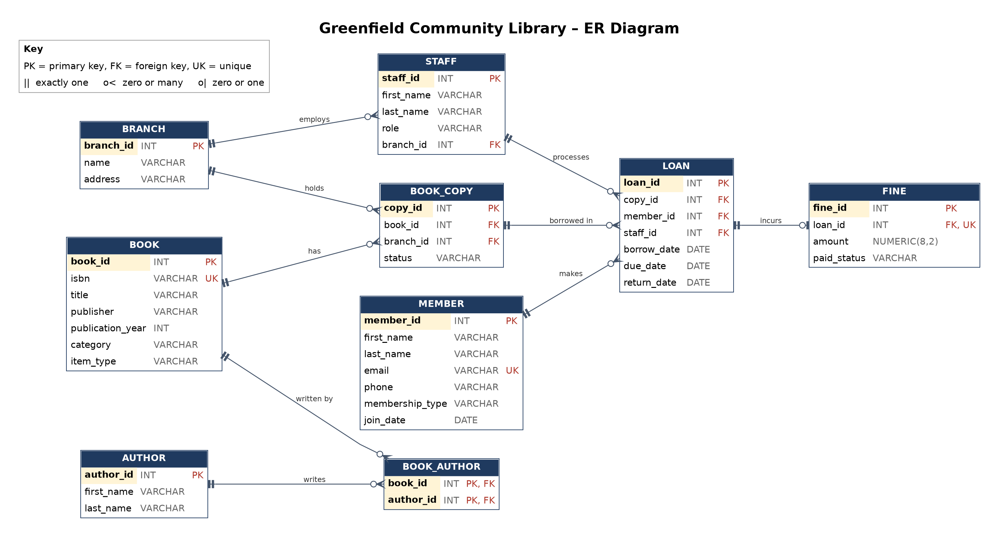

# Portfolio 1 – Database Design and Modelling

**Case study:** Greenfield Community Library Management System
(see the main repository README for the full case study statement)

This portfolio covers the conceptual design (ER diagram), the logical design
(relational schema with keys and constraints), and the normalisation of the
library database.

---

## 1. Files in this folder

| File                                | Description                                     |
| ----------------------------------- | ----------------------------------------------- |
| `er-diagram.drawio`                 | Editable ER diagram created in draw.io          |
| `er-diagram.png`                    | Exported image of the ER diagram                |
| `schema.sql`                        | PostgreSQL script that creates all nine tables  |
| `screenshots/schema-run-result.png` | Output of running `schema.sql` in pgAdmin       |
| `screenshots/tables-list.png`       | The created tables shown in the pgAdmin browser |

---

## 2. ER Diagram



### Entities and relationships

| Relationship       | Cardinality        | Meaning                                                                |
| ------------------ | ------------------ | ---------------------------------------------------------------------- |
| Branch – Book_Copy | One to many        | A branch holds many copies; each copy belongs to one branch            |
| Branch – Staff     | One to many        | A branch employs many staff; each staff member works at one branch     |
| Book – Book_Copy   | One to many        | One title can have many physical copies                                |
| Book – Author      | Many to many       | Resolved with the `book_author` junction table                         |
| Member – Loan      | One to many        | A member can make many loans over time                                 |
| Book_Copy – Loan   | One to many        | A copy can be borrowed many times, but only one loan at a time is open |
| Staff – Loan       | One to many        | A staff member processes many loans                                    |
| Loan – Fine        | One to zero-or-one | A loan has at most one fine                                            |

---

## 3. Relational Schema

```
branch      (branch_id PK, name UK, address)
book        (book_id PK, isbn UK, title, publisher, publication_year, category, item_type)
author      (author_id PK, first_name, last_name)
book_author (book_id PK/FK → book, author_id PK/FK → author)
book_copy   (copy_id PK, book_id FK → book, branch_id FK → branch, status)
member      (member_id PK, first_name, last_name, email UK, phone, membership_type, join_date)
staff       (staff_id PK, first_name, last_name, role, branch_id FK → branch)
loan        (loan_id PK, copy_id FK → book_copy, member_id FK → member,
             staff_id FK → staff, borrow_date, due_date, return_date)
fine        (fine_id PK, loan_id FK/UK → loan, amount, paid_status)
```

### Keys

- **Primary keys:** every table has a surrogate integer key generated
  automatically with `GENERATED BY DEFAULT AS IDENTITY`. The exception is
  `book_author`, which uses a composite primary key `(book_id, author_id)` so
  the same author cannot be linked to the same book twice.
- **Foreign keys:** these enforce referential integrity. For example, a loan
  cannot be created for a member or copy that does not exist.
- **Unique keys:** `isbn`, `member.email` and `branch.name` must be unique.
  `fine.loan_id` is unique, which is what makes Loan–Fine a one-to-zero-or-one
  relationship instead of one-to-many.

### Constraints (business rules enforced by the database)

| Constraint                                                   | Rule it enforces                                                           |
| ------------------------------------------------------------ | -------------------------------------------------------------------------- |
| `CHECK (item_type IN ('Book','Journal','E-book'))`           | Only valid item types can be stored                                        |
| `CHECK (status IN ('Available','On Loan','Lost','Damaged'))` | A copy always has a valid status                                           |
| `CHECK (due_date > borrow_date)`                             | A book cannot be due before it is borrowed                                 |
| `CHECK (return_date IS NULL OR return_date >= borrow_date)`  | A book cannot be returned before it was borrowed; NULL means still on loan |
| `CHECK (amount > 0)`                                         | Fines must be a positive amount                                            |
| `CHECK (role IN (...))`, `CHECK (membership_type IN (...))`  | Only recognised roles and membership types                                 |
| `NOT NULL` on required columns                               | Essential data such as title, email and due date cannot be missing         |
| `DEFAULT CURRENT_DATE`                                       | Join and borrow dates are filled in automatically                          |

### Testing the constraints

After creating the tables, I inserted test data to confirm the constraints
work. The database correctly rejected:

- a second fine on the same loan (unique constraint on `fine.loan_id`)
- a loan referencing a copy that does not exist (foreign key)
- a book with an invalid item type such as 'Magazine' (check constraint)

---

## 4. Normalisation

Normalisation organises data into tables so that each fact is stored once.
This prevents **anomalies**: errors that happen when the same data is
repeated in many places.

### Starting point: an unnormalised table

Without normalisation, a library might record loans in one wide table,
much like a spreadsheet:

| loan_id | member_name | member_email   | book_title        | isbn           | authors                      | branch_name | branch_address | borrow_date | due_date   | fine   |
| ------- | ----------- | -------------- | ----------------- | -------------- | ---------------------------- | ----------- | -------------- | ----------- | ---------- | ------ |
| 1       | Ada Obi     | ada@mail.com   | Things Fall Apart | 978-0385474542 | Chinua Achebe                | Central     | 12 Main St     | 2026-10-01  | 2026-10-15 |        |
| 2       | Ada Obi     | ada@mail.com   | Good Omens        | 978-0060853983 | Terry Pratchett, Neil Gaiman | Central     | 12 Main St     | 2026-10-03  | 2026-10-17 | 500.00 |
| 3       | Tunde Bello | tunde@mail.com | Things Fall Apart | 978-0385474542 | Chinua Achebe                | Eastside    | 4 Lake Rd      | 2026-10-05  | 2026-10-19 |        |

This design causes three problems:

- **Update anomaly:** if Ada changes her email, it must be updated on every
  row where she appears. Missing one leaves contradictory data.
- **Insertion anomaly:** a new book or member cannot be recorded until
  someone borrows something.
- **Deletion anomaly:** deleting Tunde's only loan also deletes the only
  record that he is a member.

### First Normal Form (1NF): atomic values, no repeating groups

A table is in 1NF when every cell holds a single value and every row is
uniquely identified. The `authors` column breaks this rule, because
"Terry Pratchett, Neil Gaiman" is two values in one cell, which makes it
impossible to search or link authors reliably.

**Fix:** authors are moved into their own `author` table, with one row per
author, and linked to books through `book_author`, with one row per
book–author pair. Names are also split into `first_name` and `last_name`.

### Second Normal Form (2NF): no partial dependencies

A table is in 2NF when it is in 1NF and every non-key column depends on the
**whole** primary key, not just part of it. This matters for tables with a
composite key.

If the book–author link were stored as
`(isbn, author_id, title, author_name)` with the key `(isbn, author_id)`,
then `title` would depend only on `isbn` and `author_name` only on
`author_id`. Each depends on just part of the key.

**Fix:** `book_author` contains only the two key columns. Title lives in
`book`, and author names live in `author`.

### Third Normal Form (3NF): no transitive dependencies

A table is in 3NF when it is in 2NF and no non-key column depends on
another non-key column. In the original table:

- `member_email` depends on the member, not on the loan
  (loan_id → member → email)
- `book_title` depends on the ISBN, not on the loan
- `branch_address` depends on the branch, not on the loan

**Fix:** each of these facts moves to the table it actually describes
(`member`, `book`, `branch`), and `loan` keeps only foreign keys pointing
to them. Ada's email is now stored once in `member`, so changing it
updates every one of her loans automatically.

### Result

Every table in the final schema is in **3NF**: each non-key column
describes only its own table's primary key. The three anomalies above can
no longer occur:

- members and books can be added without any loans
- deleting a loan no longer deletes member or book information
- each fact is updated in exactly one place

---

## 5. Design Decisions

- **Book vs Book_Copy:** `book` stores the title information once, and
  `book_copy` stores each physical item at a branch. Members borrow a
  specific copy, which allows the library to track exactly which item is
  out and at which branch it is held.
- **No stored "available copies" count:** the number of available copies is
  calculated from `book_copy.status` when needed. Storing a count would
  duplicate data and could fall out of sync with the actual copies.
- **Fine as a separate table:** most loans have no fine. Keeping fines in
  their own table avoids a mostly empty column in `loan` and keeps
  payment tracking separate.
- **`return_date` allows NULL:** a NULL return date means the book is still
  on loan, which makes current and overdue loans easy to query.
- **`book_copy` instead of `copy`:** COPY is also the name of a PostgreSQL
  command, so a clearer name was used to avoid confusion.
- **`NUMERIC(8,2)` for money:** this stores exact values, avoiding the
  rounding errors that floating-point types can introduce.

---

## 6. How to Run

1. In pgAdmin, create a database called `library_db`.
2. Select `library_db` and open **Tools → Query Tool**.
3. Open `schema.sql` and run it (F5).
4. The final query lists all nine tables and their column counts.

The script drops existing tables first, so it can be re-run safely.

### Evidence


